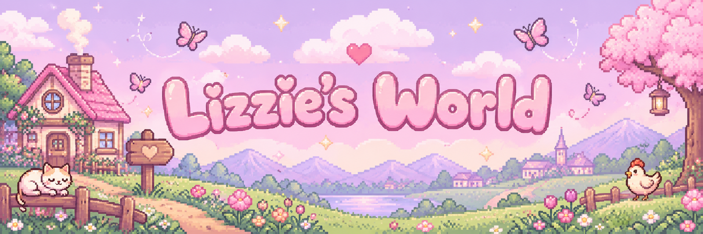

# 🌸 Welcome to my little corner of GitHub!

  

  

  🌷 <b>IT Support</b> · 🤖 <b>AI Explorer</b> · 🔐 <b>Cybersecurity Enthusiast</b>

  
  
  

---

## 🌼 A little about me

Hello! I'm Lizzie.

I'm interested in exploring how technology works, building things from scratch and finding new ways to make computers do interesting things.

Currently exploring:

- 🤖 Local AI models and multi-agent systems
- 🔐 Cybersecurity, SIEM and threat detection
- 🐍 Python and automation
- 🖥️ Linux, Windows and networking
- 🧠 Learning how AI agents think, use tools and interact with the world

🌷 A little more about my journey...

I started out working in IT support, helping people solve technical problems across different systems and devices.

Alongside that, I've been developing my technical skills through hands-on projects, experimenting with Linux, cybersecurity tools, Python and local AI models.

I particularly enjoy understanding how things work rather than just following instructions.

---

## 🎮 My project garden

*A little collection of things I've been growing...*

### 🌸 Cybersecurity garden

| Project | Description |
|---|---|
| [🔐 SIEM Home Lab](https://github.com/Li-zzie/siem-home-lab) | A SOC-style monitoring environment using Windows and Linux logs to detect simulated attacks. |
| [🦕 Stegosaurus](https://github.com/Li-zzie/Stegosaurus) | A Python steganography and CTF flag-hunting toolkit. |

### 🤖 The AI greenhouse

| Project | Description |
|---|---|
| [🧠 My Agent](https://github.com/Li-zzie/my-agent) | A local AI agent built with Python and Ollama, exploring tool use, web research and document creation. |

---

## 🧰 My inventory

  

---

## 📜 Current quests

- [ ] Expand my local AI agent.
- [ ] Experiment with multi-agent collaboration.
- [ ] Develop my cybersecurity home lab.
- [ ] Improve my Python skills.
- [ ] Build more practical automation projects.

---

  🌷 <i>Growing, learning and building one little project at a time.</i> 🌷

  

<!--
**Li-zzie/Li-zzie** is a ✨ _special_ ✨ repository because its `README.md` (this file) appears on your GitHub profile.

Here are some ideas to get you started:

- 🔭 I’m currently working on ...
- 🌱 I’m currently learning ...
- 👯 I’m looking to collaborate on ...
- 🤔 I’m looking for help with ...
- 💬 Ask me about ...
- 📫 How to reach me: ...
- 😄 Pronouns: ...
- ⚡ Fun fact: ...
-->
